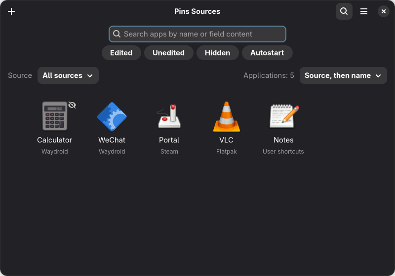

# Pins Sources

A small personal fork of [Pins](https://github.com/fabrialberio/Pins) by
**Fabrizio Alberio**, based on upstream **v2.4.8**
(`4eedcdd4b8792f8e5ef3d6dd247e78b76d683ec6`). The change adds application-source
filtering and sorting to the existing launcher editor.

Pins is a standalone GTK 4 / libadwaita application that edits `.desktop` files,
not a GNOME Shell extension. **Sorting changes the list inside Pins Sources; it
does not rearrange GNOME's application grid.** Hiding a launcher uses the original
Pins editor and does affect its visibility in the application menu.

## What this fork adds

When Android apps, Steam games and desktop applications share one menu, finding
the launchers you want to edit or hide can be tedious. This fork adds:

- A **Source** dropdown: Waydroid, Steam, Flatpak, Snap, Wine, AppImage,
  system packages, user shortcuts and other sources.
- A source label on each application tile.
- A **Source, then name** sorting option, alongside sorting by name.
- Source filtering combined with the existing search and visibility filters.
  The source and sorting preferences are saved in the fork's own settings.

The original launcher editor is retained. This fork does not add an uninstaller
or change the applications themselves.



## How to use it

1. Open **Pins Sources** and select a source, for example **Waydroid**, in the
   dropdown above the application list. Select **All sources** to clear it.
2. In the sorting dropdown, choose **Source, then name**
   (**По источнику и имени** in Russian) to put applications from the same source
   together. Choose **Name** to return to name sorting.
3. To hide a launcher, open its tile, enable **Invisible** and go back to save.
   Use the existing **Hidden** search filter to find it and make it visible again.

Source detection uses launcher metadata, its path and the parsed `Exec` command;
**it never runs that command**. It is a heuristic, not a package-manager query.
For example, a Steam game launched through Flatpak is labeled Steam, while the
Flatpak Steam client is labeled Flatpak. “System packages” means a launcher in a
recognized system application directory, not necessarily an essential OS app.
Unknown launchers fall back to user shortcuts or other sources. A local override
can retain its original application's source.

## Install this fork from source on Fedora

Requirements: Python 3, GCC, pkg-config, GTK 4 development files,
libadwaita **1.7 or newer**, GLib development tools and gettext.

```sh
sudo dnf install git gcc pkgconf-pkg-config gtk4-devel libadwaita-devel glib2-devel gettext desktop-file-utils
git clone --branch feature/app-origins https://github.com/FariCustomer/Pins-Sources.git
cd Pins-Sources
python3 build-local.py
bash run-local.sh
```

To add **Pins Sources** to your application menu:

```sh
python3 install-local.py
```

This installs a launcher for the build in this checkout, without sudo. **Keep the
checkout in place**; rerun the installer if you move it. The application/settings
ID is `io.github.mechamorf.PinsSources`, separate from upstream Pins. Both editors
operate on the same real application launchers, so edits made to those launchers
are shared. No prebuilt release or Flathub version of this fork is provided.

The checked environment is Fedora 45 with GTK 4.24.1 and libadwaita 1.10.0.
Other distributions and GNOME versions have not been verified. The inherited
Flatpak development manifest has the fork's ID and command, but that packaging
route has not been validated; the native build above is the documented route.

## Checks and code to review

`python3 build-local.py` builds the application, runs the 29 existing
classification cases and builds the GTK UI integration test. Run the UI test
inside a graphical session:

```sh
mkdir -p qa
GSETTINGS_SCHEMA_DIR="$PWD/build-local/schemas" \
PINS_TEST_SCREENSHOTS="$PWD/qa" GSK_RENDERER=cairo build-local/test-ui
```

The UI test uses temporary launcher files and an in-memory settings backend. It
checks source filtering, search, hidden applications, empty results, source
sorting, opening the editor, visibility persistence, original-source retention
and a narrow window. It does not edit your installed application launchers.
Generated binaries and test screenshots are excluded from Git.

The main changes are in [`src/pins-app-origin.c`](src/pins-app-origin.c)
(classification), [`src/pins-app-filter.c`](src/pins-app-filter.c) (filtering and
sorting) and [`src/pins-home-view.c`](src/pins-home-view.c) / its UI template
(controls). Existing checks are in [`tests/`](tests/).
See [the fork notes](README.SOURCES.md) for build details and validation limits.

## Upstream and license

This is a fork, not an official Pins release. Original author credits, source
headers, translations and the [GPL license text](COPYING) are retained; source
headers specify **GPL-3.0-or-later**. Fork modifications are by **Fara**.

The [original README](docs/UPSTREAM-README.md) is preserved unchanged, including
upstream's installation link. That link installs original Pins, **not this fork**.
